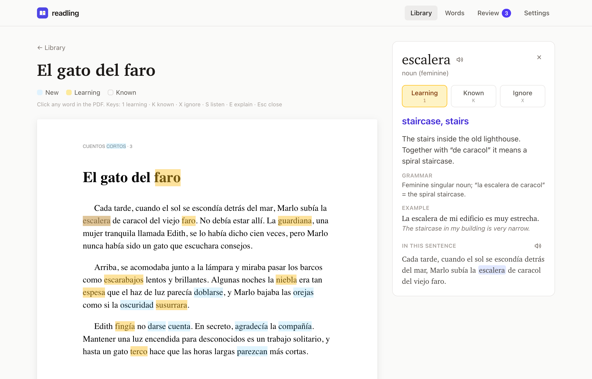
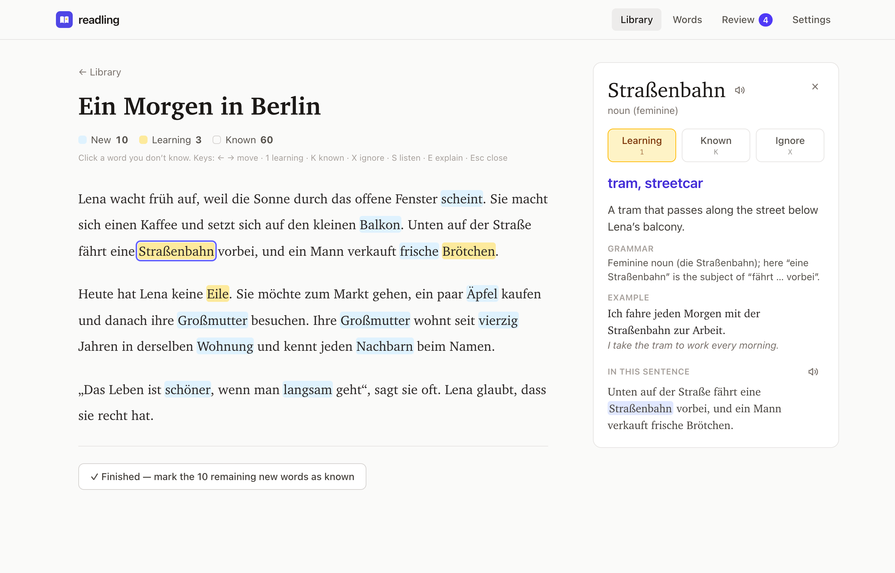
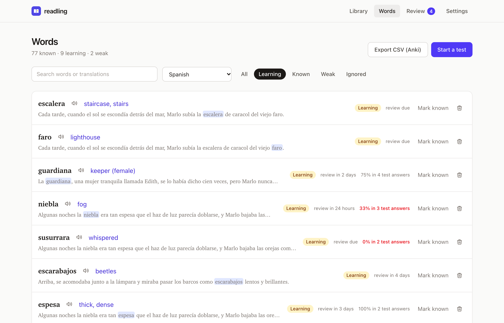
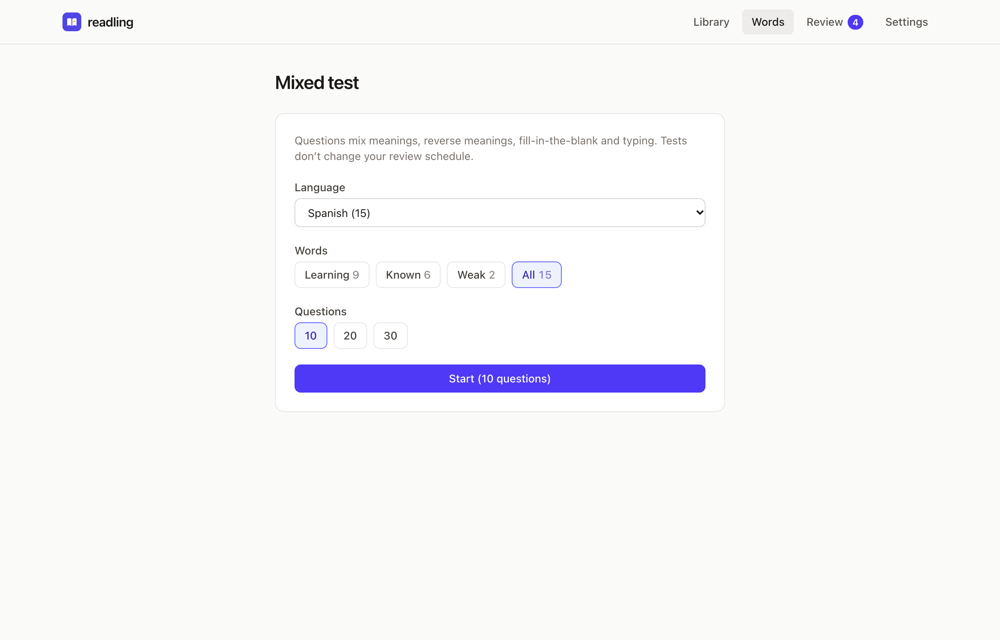
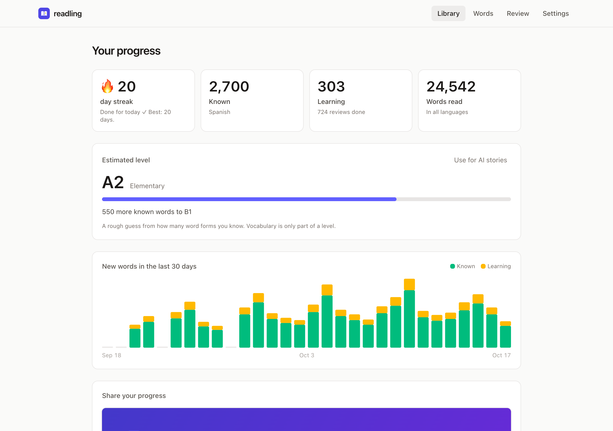
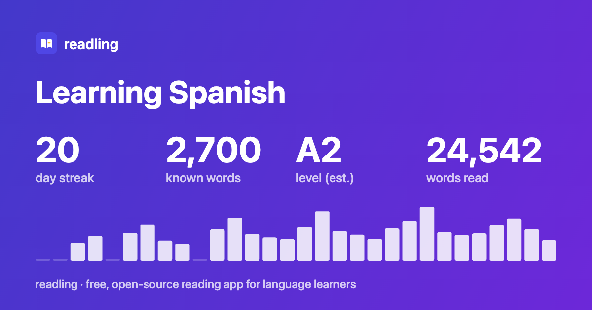

<div align="center">


# readling

**Sevdiğin şeyleri okuyarak dil öğren.**

Makaleler, EPUB kitaplar ya da metin içeren PDF'ler oku; bilmediğin kelimelere tıkla ve AI'dan *o cümledeki* anlamlarını öğren.<br>
Öğrendiğin kelimeler aralıklı tekrar ve kısa testlerle yeniden karşına çıkar.

Açık kaynak · Tarayıcıda çalışır · Cihaz içi AI ya da kendi AI'ın · Hesap ve uygulama sunucusu gerektirmez

[Özellikler](#özellikler) · [Hızlı başlangıç](#hızlı-başlangıç) · [AI sağlayıcıları](#ai-sağlayıcıları) · [Gizlilik](#gizlilik) · [English](README.md)

<!-- TODO: yayına alınınca buraya "Canlı demo" bağlantısı ekle. -->

</div>

<br>

<picture>
  <source media="(prefers-color-scheme: dark)" srcset="docs/screenshots/reader-pdf-dark.png">
  
</picture>

## Neden readling

readling; okumayı, kelime takibini ve alıştırmayı statik bir web uygulamasında bir araya getirir:

- **Kitaplığın tarayıcında kalır.** readling hesabı veya uygulama sunucusu gerekmez. Yayınlanmış bir kopyayı kullanabilir ya da statik dosyaları kendin barındırabilirsin.
- **AI'ın nerede çalışacağını sen seç.** Desteklenen cihazlarda ücretsiz tarayıcı AI'ını, kendi API anahtarını, Ollama'yı veya yerel kodlama ajanı köprüsünü kullan. Tarayıcı AI'ının kullanılabilirliği tarayıcıya, donanıma ve dil çiftine bağlıdır; ayrıntılar [AI sağlayıcıları](#ai-sağlayıcıları) bölümünde.
- **Kelimeleri bağlamıyla öğren.** Tam AI açıklamaları, seçilen cümledeki anlamı, dil bilgisini ve bir örneği içerir. Yalnızca tarayıcı çevirisi kullanılabiliyorsa kelime ve cümle çevirileri gösterilir.
- **Alıştırma için AI zorunlu değil.** Okuma, kelime takibi ve tekrar AI olmadan çalışır. Testler, kelimelerinle birlikte kayıtlı çevirileri ve kaynak cümleleri kullanır.

## Özellikler

### Ne istersen oku, istediğin kelimeye bak

Bir makale, hikâye ya da şarkı sözü yapıştır veya bir `.txt` dosyası yükle. Yeni kelimeler mavi, öğrendiklerin sarı, bildiklerin renksiz görünür. Henüz takip etmediğin bir kelimeye tıklamak onu öğrenme listene ekler ve AI ayarlıysa açıklama ister. Kelimeleri bilinen veya yok sayılan olarak da işaretleyebilirsin.

- **Çok kelimeli ifadeler:** Aynı cümledeki 2–8 kelimenin üzerinden sürükleyerek "a pesar de" veya "give up" gibi bir ifadeyi tek öğe olarak kaydet. Metin okuyucuda `Shift+→` ile seçimi genişletip `1` ile öğrenmeye başlayabilirsin. Öğrendiğin ifadeler tekrar karşılaştığında altı çizili görünür; kelimeler gibi tekrara ve teste girebilir.
- **Cümle çevirisi:** Tek tıkla veya `T` ile seçilen kelimenin bulunduğu cümleyi açıklama diline çevir.
- **Dinleyerek oku:** Metin sayfasını sesli oynat veya duraklat, seçtiğin cümleden başla ve okuma hızını değiştir. Okunan cümle vurgulanır; tarayıcı sesi kelime sınırlarını bildirdiğinde kelimeler de ayrı ayrı vurgulanır.
- **Furigana ve pinyin:** Japonca kanjilerin ve Çince karakterlerin üstünde isteğe bağlı okunuşlar gösterilir, hesaplama cihazında yapılır.
- **Uzun metinlere kaldığın yerden devam et:** Metinler yaklaşık 350 kelimelik sayfalara bölünür; readling son açtığın sayfayı hatırlar.
- **Sayfaları tek tek tamamla:** "Bu sayfa bitti" yalnızca o sayfadaki kalan yeni kelimeleri bilinen yapar, okumayı kaydeder ve varsa sonraki sayfaya geçer. Öğrenmekte olduğun kelimelerin durumu değişmez. Yeni kelime kalmadığında da sayfayı okundu olarak kaydedebilirsin.
- **Güncel kelime kapsamı:** Kitaplık, her metindeki bilinen ve öğrenilen kelimeleri gösterir. Kelime durumları, Kelimeler sayfasından veya başka bir metinden değiştirildiğinde de güncellenir.
- **Sana göre zorluk:** Bir dilde en az 100 bilinen kelimeye ulaştığında metin önizlemeleri, henüz bilmediğin kelimelerin oranını ve *Kolay*, *Tam kıvamında*, *Zorlayıcı* veya *Zor* etiketini gösterir.



### Okumak için ne istersen getir

- **EPUB kitaplar:** DRM'siz bir EPUB içe aktar. readling bölümleri sırasıyla, varsa başlık, yazar ve dil bilgisiyle birlikte alır. Kitaplar metin okuyucuda açılır; kitabın özgün sayfa düzeni korunmaz.
- **Vikipedi:** Öğrendiğin dilde Vikipedi'de ara ve istediğin makaleyi kaynakça bölümleri olmadan oku.
- **Web makaleleri:** Chrome, Edge ve Brave için [tarayıcı eklentisiyle](extension/README.md) açık makaleyi veya seçtiğin bölümü readling'e gönder. Makale çıkarımı, mümkün olduğunda menüleri ve reklamları ayıklar. Eklentiyi depodaki `extension/` klasöründen yükle ve seçeneklerinden readling adresini ayarla.
- **Seviyene göre hikâyeler:** Bir konu yaz, A1'den C2'ye bir seviye seç; AI kısa bir hikâye yazsın, istersen öğrendiğin kelimeleri de kullanarak.
- **Sadeleştir:** AI'dan açık metin sayfasını veya tüm metni daha kolay bir seviyede yeniden yazmasını iste. Yeni sürüm ayrı bir metin olarak kaydedilir, orijinali korunur. Bu özellik metin okuyucuda bulunur.

### PDF'ler düzenini korur

PDF'ler özgün sayfa düzenini korur. readling; kelime ve ifade seçimi, cümle çevirisi ve telaffuz için PDF'in metin katmanını kullanır. Satır sonunda tireyle bölünmüş kelimeleri birleştirir, paragraf sınırlarını belirlemek için satır aralıklarından yararlanır.

Sayfalar kaydırdıkça çizilir. Uzakta kalan sayfaların çizilmiş içerikleri bellek kullanımını azaltmak için kaldırılır ve gerektiğinde yeniden oluşturulur. Her sayfanın kendi bitirme düğmesi vardır; bütün kelimeleri takip edilen bir sayfanın okunmasını da kaydedebilirsin.

PDF'in çıkarılabilir bir metin katmanı olmalıdır: taranmış görseller OCR gerektirir ve bu özellik henüz yoktur. Parola korumalı PDF'ler desteklenmez.

| Özellik | EPUB ve web içerikleri dahil metin okuyucu | PDF okuyucu |
|---|---|---|
| Kelime ve ifade takibi, AI açıklamaları, cümle çevirisi | Var | Var |
| Kelime ve cümle telaffuzu | Var | Var |
| Sayfanın tamamını kesintisiz sesli okuma | Var | Yok |
| Furigana ve pinyin | Metin içinde ve kelime panelinde | Kelime panelinde |
| Sayfa konumunu hatırlama, kitaplıkta kelime kapsamı ve zorluk | Var | Yok |
| AI ile sadeleştirme | Açık sayfa veya tüm metin | Yok |

### Bütün kelimelerin tek yerde

Baktığın her kelimeyi dile ve duruma göre arayıp filtreleyebilirsin. Sürekli yanlış yaptığın **zayıf** kelimeler için ayrı bir filtre de var. Her kelimenin yanında onunla karşılaştığın cümle, bir sonraki tekrar zamanı ve testlerdeki başarın görünür. Listeyi Anki için CSV olarak dışa aktarabilirsin.



### Tekrar ve test

- **Aralıklı tekrar**, öğrenilen kelime ve ifadeleri [FSRS](https://github.com/open-spaced-repetition/ts-fsrs) ile planlar. Gerekirse son cevabı geri alabilirsin. AI ayarlıysa, kaynak cümlesi kayıtlı bir kartın eksik açıklaması tekrar sırasında getirilebilir.
- **Karışık testler** dört soru tipini birleştirir: anlam, ters anlam, boşluk doldurma ve yazma. Sorular kayıtlı çevirilerinden ve kaynak cümlelerinden üretilir; kullanılabilecek tipler kelime verilerine bağlıdır. AI çağrısı yapılmaz.
  - Yanlış şıklar kendi kelime hazinenden gelir ve mümkünse aynı türden seçilir.
  - Yazma sorularında eksik aksanlar ve en az beş karakterlik cevaplarda tek bir yazım hatası yakın cevap olarak kabul edilir. Arapça ve İbranicede isteğe bağlı hareke işaretleri hata sayılmaz.
- **Testler tekrar takvimini değiştirmez.** Tek tıkla yanlış yaptığın kelimeleri tekrara gönderebilirsin.



### Görebileceğin ve paylaşabileceğin ilerleme

Günlük etkinlik serisi, okuma ve alıştırma toplamları, 30 günlük kelime etkinliği grafiği ve paylaşabileceğin veya indirebileceğin bir ilerleme görseli. Okuma, kelime ekleme, tekrar ve test etkinliklerinin hepsi günlük seriye katkıda bulunur.

CEFR tahmini, bildiğin kelime biçimlerine dayalı yaklaşık bir göstergedir; dil seviyeni ölçen bir sınav değildir. AI hikâyelerinin seviyesini seçmene yardımcı olabilir.





### Ayrıca

- **Telaffuz:** Herhangi bir kelimeyi ya da cümleyi tarayıcının yerleşik sesleriyle dinle. readling için AI API anahtarı gerekmez. Yüklü yerel sesler çevrimdışı çalışır; diğer sesler tarayıcının veya işletim sisteminin konuşma hizmetini kullanabilir.
- **Kurulabilir ve çevrimdışı:** readling'i bir uygulama gibi ana ekrana ya da Dock'a ekle. Yayın için derlenen sürüm yüklenip dosyaları önbelleğe alındıktan sonra kayıtlı metinler, PDF'ler, kelimeler ve alıştırmalar çevrimdışı kullanılabilir. Bulut AI, Vikipedi ve ilk model veya Japonca sözlük indirmesi bağlantı gerektirir.
- **Klavye öncelikli:** aşağıdaki [kısayollara](#klavye-kısayolları) bak.
- **Açık ve koyu tema**, telefonda da çalışan bir düzen.
- **Yedekleme:** Metinleri, gömülü PDF dosyalarını, kelimeleri (kayıtlı açıklamalarıyla), tekrar planlarını, test sonuçlarını ve etkinlikleri tek bir JSON dosyasına aktar. Ayarlar, API anahtarları ve AI önbelleği dahil edilmez. Yedekler geri yüklemeden önce doğrulanır; mevcut verilerle birleştirilirken daha güncel kelime ilerlemesi ve test geçmişi korunur. readling yedek almanı da hatırlatır. Cihazlar arası aktarım elle yapılır; otomatik senkronizasyon henüz yoktur.
- **Rehberli başlangıç:** Dillerini ve bir AI seç, sonra örnek bir metin aç.

### Desteklenen diller

**18 okuma dili:** İngilizce, Almanca, İspanyolca, Fransızca, İtalyanca, Portekizce, Felemenkçe, İsveççe, Lehçe, Rusça, Ukraynaca, Türkçe, Japonca, Çince, Korece, Arapça, Farsça ve İbranice.

Japonca ve Çince, boşluk olmadan kelimelere ayrılır. Arapça, Farsça ve İbranice için sağdan sola okuma düzeni ve buna uygun klavye gezinmesi bulunur. Arapça ve İbranicede isteğe bağlı harekeler, kelime takibinde ve testlerde aynı kelimenin farklı sayılmasına yol açmaz.

**5 arayüz dili:** Türkçe, İngilizce, İspanyolca, Almanca ve Portekizce. Bir okuma dilinin desteklenmesi, bütün AI sağlayıcılarının veya tarayıcı seslerinin o dili desteklediği anlamına gelmez.

## Hızlı başlangıç

Node.js 22.18 veya daha yenisi gerekiyor. Depoyu **Code** düğmesindeki adresle klonla veya ZIP olarak indirip aç; ardından proje klasöründe bir terminal aç.

```bash
npm ci
npm run dev
```

Yazdırılan adresi aç. Kitaplıkta iki örnek metin (İngilizce ve Almanca) hazır olarak gelir. Okuma ve açıklama dillerini seç; ardından açıklamalar, çeviriler, hikâyeler ve sadeleştirme için **Ayarlar**'dan bir [AI sağlayıcısı](#ai-sağlayıcıları) yapılandır. AI olmadan da okumaya ve kelime takibine başlayabilirsin.

### Geliştirme kontrolleri

```bash
npm run lint
npm run typecheck
npm test
```

Geliştirme ve yerelleştirme ayrıntıları için [CONTRIBUTING.md](CONTRIBUTING.md)'ye bak.

### Yayına alma

```bash
npm run build
```

Üretim derlemesini `npm run preview` ile yerelde önizle. Japonca okunuşlar için `kuromoji-dict/` dahil `dist/` klasörünün tamamını statik bir sunucuya yükle. Yayınlanan kopyada kurulum ve çevrimdışı destek için HTTPS kullan; yerel kullanımda localhost uygundur.

GitHub Pages proje sitesi gibi bir alt yolda yayınlamak için `npm run build -- --base=/readling/` ile derle. Yayın kontrolleri [yayın rehberinde](docs/RELEASING.md) bulunur.

## AI sağlayıcıları

| Sağlayıcı | Gerekenler |
|---|---|
| **Tarayıcı AI'ı** (ücretsiz, cihaz içi) | Desteklenen Prompt ve/veya Translator API'lerini sunan bir tarayıcı; örneğin uyumlu bir masaüstü Chrome kurulumu. Kullanılabilirliği Ayarlar'dan kontrol et; dil çifti ve donanım, sunulan özellikleri etkiler. |
| **Anthropic (Claude)** | Bir API anahtarı ve erişebildiğin bir model. Ayarlar'da, gerektiren anahtarlar için Workspace ID alanı da bulunur. |
| **OpenRouter**, **OpenAI**, **Google Gemini** | Bir API anahtarı ve hesabının erişebildiği bir model kimliği. |
| **Ollama** (ücretsiz, yerel) | İndirilmiş bir model, ve uygulamanın adresine izin verecek şekilde başlatılmış Ollama: `OLLAMA_ORIGINS=http://localhost:5173 ollama serve` |
| **Özel** | OpenAI uyumlu bir Chat Completions adresi ve model kimliği; sunucu gerektiriyorsa API anahtarı. Sunucu, uygulamanın adresinden gelen isteklere izin vermelidir. |
| **Claude Code, Codex, Antigravity** (deneysel) | Kurulu ve oturum açılmış CLI, artı yerel köprü. [Aşağıya](#kodlama-ajanı-cliları-deneysel) bak. |

Model kimlikleri Ayarlar'dan değiştirilebilir. Sağlayıcında erişebildiğin bir model seç; önerilen bir model adı erişim garantisi değildir. Farklı bir yerel port veya yayınlanmış bir kopya kullanıyorsan Ollama'nın izin verilen adresini bu URL'ye göre güncelle.

### Tarayıcı AI'ı neler yapabilir?

- **Çeviri:** Translator API, istenen dil çiftini destekliyorsa dil modellerini ilk kullanımda indirir. Hazır bir Prompt modeli yoksa kelime ve cümle çevirileri gösterilir; dil bilgisi notları ve üretilmiş örnekler sunulmaz.
- **Tam açıklamalar:** Gemini Nano indirmesini Ayarlar'dan başlat. Gerekli özellikler kullanılabiliyorsa readling açıklamayı doğrudan üretir veya İngilizce üretip açıklama diline çevirir.
- **Hikâye ve sadeleştirme:** Hazır bir Prompt modeli ve istenen dil için destek gerekir. Uygulama şu anda doğrudan Prompt çıktısını İngilizce, İspanyolca, Almanca, Fransızca ve Japonca için etkinleştirir.

İlk model indirmeleri bağlantı gerektirir. Gerekli modeller hazır olduğunda tarayıcı AI'ı cihazında çalışır. Masaüstü Chrome'un kurulu olması tek başına bu API'lerin veya dillerin kullanılabileceğini garanti etmez.

### Kodlama ajanı CLI'ları (deneysel)

Bir web sayfası bilgisayarında program başlatamaz. Bu yüzden readling, CLI'ı onun yerine çalıştıran, bağımlılığı olmayan küçük bir yerel **köprü** içerir:

```bash
npm run bridge
```

Ayarlar'da **Bu bilgisayardaki CLI** altından aracı seç ve köprünün yazdırdığı eşleştirme kodunu yapıştır.

<details>
<summary>Köprü bilgisayarını nasıl korur</summary>

- **Ağ:** Yalnızca `127.0.0.1:8787` adresini dinler. Beklenmeyen `Host` başlıklarını reddeder, böylece DNS rebinding saldırılarına karşı korur.
- **Kimlik doğrulama:** Her istek eşleştirme kodu ister. Kod `~/.config/readling/bridge-token` dosyasında 600 izniyle saklanır. Tarayıcıdan gelen isteklerin ayrıca izin verilen bir adresten gelmesi gerekir. Kendi adresini `READLING_ORIGINS=https://site-adresin.example` ile eklersin.
- **Yalıtım:** Her çalıştırma yeni ve boş bir geçici klasörde yapılır, komut kabuk kullanılmadan iletilir.
  - **Claude Code:** Araçlar, MCP sunucuları, hook'lar, slash komutları, CLAUDE.md dosyaları ve oturum kaydı kapalıdır.
  - **Codex:** Salt okunur sandbox'ta çalışır, kullanıcı ayarlarını yok sayar ve hiçbir şey kaydetmez.
  - **Antigravity:** Terminal sandbox'ı açık çalışır. CLI'da araçları tamamen kapatan bir seçenek yok.
- **Sınırlar:** İstek boyutu, eşzamanlı çalışma (2) ve çalışma süresi (2 dakika) sınırlıdır. Takılan bir çalışma, başlattığı süreçlerle birlikte sonlandırılır.
- **Yapılandırma:** `READLING_BRIDGE_PORT`, `READLING_ORIGINS`, `READLING_BRIDGE_TOKEN`, `READLING_BRIDGE_TIMEOUT_MS`. `PATH`'te olmayan CLI'lar için `READLING_CLAUDE_BIN` / `READLING_CODEX_BIN` / `READLING_AGY_BIN`.

</details>

> [!IMPORTANT]
> Köprü, kurulu CLI'ını kendi oturumunla çalıştırır. Üçüncü parti uygulamalardan kullanım için sağlayıcının güncel koşullarını, Claude Code kullanıyorsan [Anthropic'in koşullarını](https://code.claude.com/docs/en/legal-and-compliance) kontrol et. Köprü bu koşulları değiştirmez. Ayarlar'da API anahtarıyla çalışan sağlayıcılar da bulunur.

## Gizlilik

- **Sunucu yok.** readling'in bir sunucusu yok, kullanım verisi de toplanmaz.
- **Veriler tarayıcıda.** Metinler, PDF'ler, kelimeler ve ayarlar tarayıcında (IndexedDB ve localStorage) saklanır.
- **Kelime açıklamaları:** Seçilen kelime veya ifade, bulunduğu cümle ve dil tercihlerin yapılandırdığın AI adresine gider. Tekrar kartları da kayıtlı cümle için eksik açıklamayı isteyebilir.
- **Cümle çevirileri:** Çeviri istediğinde seçilen cümle ile kaynak ve hedef diller gönderilir.
- **Hikâyeler:** Konu, dil, seviye, uzunluk ve seçtiğin alıştırma kelimeleri AI'a gönderilir. **Sadeleştirme** için başlık, seçilen sayfa veya tüm metin, dil ve hedef seviye gönderilir.
- **AI'ın çalıştığı yer:** Tarayıcının yerleşik AI'ı, modeller indirildikten sonra istekleri cihazında işler. Ollama yapılandırdığın adreste çalışır; agent entegrasyonları istekleri yerel köprü üzerinden CLI'a ve sağlayıcısına iletir. Bulut sağlayıcıları istekleri doğrudan tarayıcından alır. API anahtarları ilgili sağlayıcı için yapılandırdığın adrese gönderilir.
- **Sesli okuma:** Yerel sesler cihazında çalışır. Yerel olmayan tarayıcı veya işletim sistemi sesleri okunacak metni konuşma hizmetine gönderebilir ve bağlantı gerektirebilir.
- **İçe aktarma.** EPUB dosyaları tarayıcında okunur. Vikipedi aramaları tarayıcından doğrudan Vikipedi'ye gider. Eklenti sayfaları yalnızca readling sekmene verir, başka hiçbir yere göndermez.
- **Furigana yerelde kalır.** Japonca sözlük (yaklaşık 18 MB) readling'in kendisi tarafından sunulur ve yalnızca furiganayı açtığında indirilir. Pinyin için ayrı bir sözlük indirmesi gerekmez.
- **Daha az istek.** Açıklamalar ve cümle çevirileri içerik ve hedef dile göre önbelleğe alınır; mevcut bir önbellek sonucu yeni isteği önler. Zaten bildiğin kelimeler sen istemedikçe gönderilmez.

Tarayıcı verileri silinebilir, o yüzden arada bir **Ayarlar**'dan yedek al. Yedekler okuma içeriklerini ve öğrenme geçmişini içerir; onları özel tut. Güvenlik açığı bildirimleri için [SECURITY.md](SECURITY.md), yayın kontrolleri için [yayın rehberine](docs/RELEASING.md) bak.

## Klavye kısayolları

| Nerede | Tuşlar |
|---|---|
| Her iki okuyucuda seçilen kelime veya ifade | `1` öğreniyorum · `K` biliyorum · `X` yoksay · `S` dinle · `E` açıkla · `T` cümleyi çevir · `Esc` kapat |
| Metin okuyucu | `←` `→` kelimeler arasında gezin · `Shift+→` seçimi genişlet · `Shift+←` seçimi daralt · `P` sayfanın sesli okumasını başlat/duraklat |
| Tekrar | `Boşluk` veya `Enter` cevabı göster · `1`–`4` puanla · `Z` geri al |
| Test | `1`–`4` şık seç · `Enter` yazılı cevabı gönder veya devam et |

Sağdan sola metinlerde ok tuşlarının yönü tersine döner. Klavyeyle ifade seçimi tek cümle içinde ve en fazla sekiz kelimeyle sınırlıdır; seçili ifadeyi öğrenme listene eklemek için `1`'e bas.

## Teknolojiler

React 19 · TypeScript · Vite · Tailwind CSS v4 · Dexie (IndexedDB) · [ts-fsrs](https://github.com/open-spaced-repetition/ts-fsrs) · [pdf.js](https://mozilla.github.io/pdf.js/) · [fflate](https://github.com/101arrowz/fflate) · [kuromoji.js](https://github.com/takuyaa/kuromoji.js) · [pinyin-pro](https://github.com/zh-lx/pinyin-pro) · Anthropic SDK · Chrome'un yerleşik AI API'leri · vite-plugin-pwa · Vitest

PDF kütüphanesi ve AI istemcileri yalnızca gerektiğinde yüklenir, böylece ilk açılış hafif kalır. Klasör yapısı için [İngilizce README](README.md#tech-stack)'ye bak.

## Yol haritası

Yukarıdaki özellikler uygulanmış durumda. İleride eklenebilecekler:

- [ ] Web sayfalarında doğrudan kelimeye bakma
- [ ] YouTube altyazılarını içe aktarma
- [ ] Taranmış PDF'ler için OCR
- [ ] Cihazlar arası isteğe bağlı senkronizasyon
- [ ] Daha fazla arayüz dili

## Katkıda bulunma

Issue ve pull request'ler memnuniyetle karşılanır, özellikle yeni arayüz dilleri. Kurulum, klasör yapısı ve dil ekleme için [CONTRIBUTING.md](CONTRIBUTING.md)'ye bak.

## Lisans

[MIT](LICENSE)
